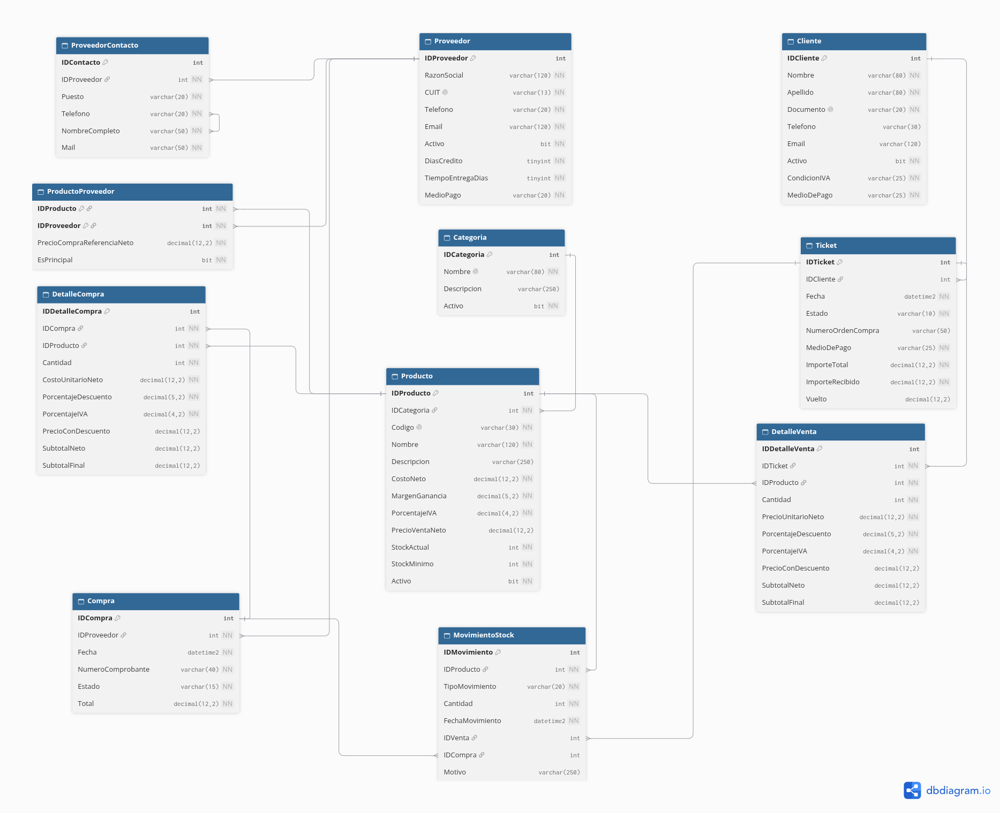

# Sistema de Gestión de Ventas, Compras y Stock — TPI Base de Datos II

Proyecto Integrador para la cátedra de **Base de Datos II** (Tecnicatura Universitaria en Programación — UTN FRGP).

* **Grupo:** 75
* **Autor:** Barbieri, Guido
* **Motor:** Microsoft SQL Server 2025

---

## Descripción del Sistema
Base de datos relacional diseñada para un comercio minorista de componentes y hardware de computación en Argentina. 

---

## Estructura del Repositorio y Orden de Ejecución

Para inicializar y poblar la base de datos correctamente desde cero, los scripts **deben ejecutarse estrictamente en el siguiente orden numérico**:

1. `CreacionBD.sql` — Crea la base de datos `BDD2_TPI`, las 11 tablas, claves primarias, foráneas, valores por defecto y restricciones `CHECK`.
2. `Triggers.sql` — Implementa los 3 triggers responsables de la automatización en cascada del inventario. *(Debe ejecutarse antes de cargar los datos, o va a haber errores de carga).*
3. `Vistas.sql` — Crea las 3 vistas comerciales y de alerta de inventario.
4. `Procedimientos.sql` — Crea los 2 procedimientos almacenados (reporte parametrizado y acción transaccional con `TRY...CATCH`).
5. `Datos.sql` — Inserta el lote de datos de ejemplo coherentes para todas las tablas y dispara las primeras trazas de stock.

---

## Objetos de Programación Implementados

### Vistas (`VIEW`)
* `VW_CatalogoProductos`: Expone los artículos activos junto a su categoría y calcula el precio final al público aplicando el porcentaje de IVA correspondiente.
* `VW_FacturacionVentas`: Consolida los comprobantes de venta agrupando sus detalles (`SUM` + `GROUP BY`) e incluyendo ventas a consumidor final anónimo mediante `LEFT JOIN`.
* `VW_AlertaStockCritico`: Monitorea los productos activos cuyo stock actual es menor o igual al stock mínimo configurado.

### Procedimientos Almacenados (`STORED PROCEDURE`)
* `SP_ConsultarMovimientosPorProducto` *(Reporte)*: Recibe `@IDProducto`, valida existencia mediante *guard clause* y lista el historial cronológico en `MovimientoStock`.
* `SP_AnularTicket` *(Acción)*: Recibe `@IDTicket`, valida que esté emitido y cambia su estado a `'ANULADO'` dentro de una transacción protegida por `BEGIN TRY...CATCH` y `ROLLBACK`.

### Disparadores (`TRIGGER`)
* `TR_ActualizarStockPorMovimiento` (`AFTER INSERT` en `MovimientoStock`): Sincroniza físicamente `Producto.StockActual` sumando o restando según el tipo de movimiento.
* `TR_DetalleCompraMovStock` (`AFTER INSERT` en `DetalleCompra`): Registra automáticamente el ingreso por compra en el Kardex, disparando en cascada la actualización de stock.
* `TR_DetalleVenta_ReponerStock` (`AFTER DELETE` en `DetalleVenta`): Lee la pseudotabla `deleted` y registra un `'AJUSTE_POSITIVO'` en el Kardex para restituir el inventario al eliminarse un ítem de venta.

---

## Diagrama Entidad-Relación (DER)

